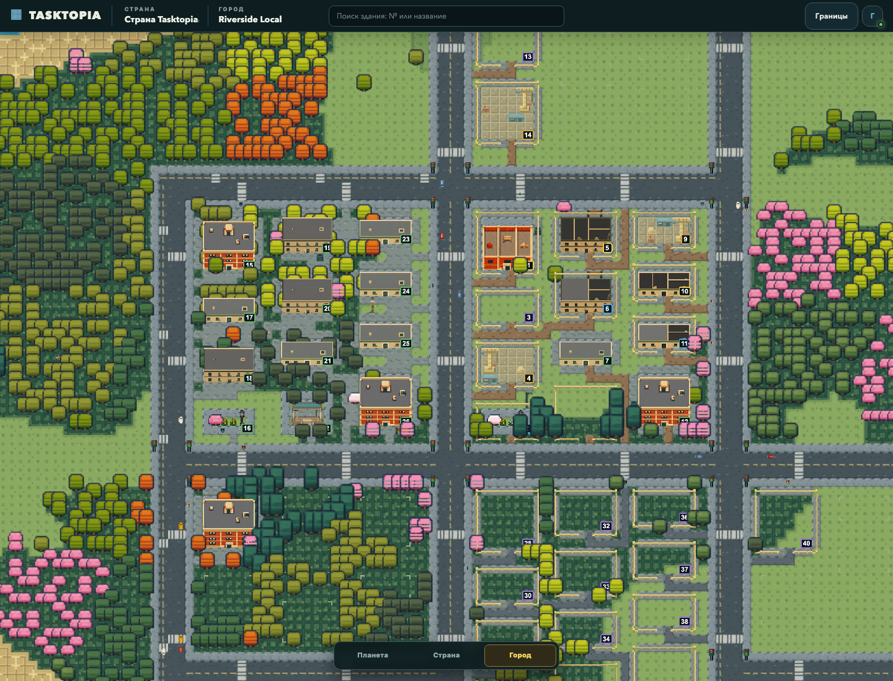

# Tasktopia

Менеджер задач, в котором проекты и ход работы отображаются на карте пиксельного города.

[Сайт](https://tasktopia.online) · [Подключение MCP](docs/MCP.md) · [Установка на сервер](docs/DEPLOYMENT.md)



## Возможности

- Задачи с ответственными, сроками, зависимостями, чек-листами и историей изменений.
- Карта с фильтрами по исполнителю, стадии и срокам; прямые ссылки на карточки задач.
- Документы проекта, управление участниками, уведомления и установка как PWA.
- Работа с задачами через MCP: создание, назначение, комментарии и смена стадий.
- Постоянные городские остановки и автобусы с реальной посадкой и высадкой;
  [обновление существующих городов](docs/tasks/68-city-transit-stops.md).
- Канонические межгородские дороги с ограниченным поиском и сохранением
  принятой геометрии; [явное обновление старых стран](docs/tasks/76-intercity-road-search.md).
  [Новые ближние и дальние коридоры](docs/tasks/81-intercity-road-hierarchy.md)
  используют разные покрытия при сохранении физической ширины и старых дорог.
  [Планетарная карта](docs/tasks/77-planet-ground-roads.md) показывает те же
  сохранённые связи нативным дорожным покрытием.
- [100 городских сценариев](docs/tasks/72-city-event-catalogue.md): дворовые
  работы, повседневная жизнь, дорожные происшествия и открытия зданий.
- [Упакованная геометрия города](docs/tasks/73-packed-city-runs.md) уменьшает
  память удерживаемой сцены; ограничения большого города указаны в отчёте.
  [Локальные реакции](docs/tasks/78-local-geometry-views.md) обходятся без
  копирования всей пешеходной и дорожной карты ради одной стройки.
  [Производная сцена](docs/tasks/82-persistent-city-scene.md) повторно
  используется после перезапуска сервера; существующие города явно
  прогреваются точной сборкой после transport/road maintenance.

| Объект проекта | На карте |
| --- | --- |
| Проект и команда | Страна |
| Направление или эпик | Город |
| Итерация или спринт | Район |
| Задача | Здание |

Задачи изменяются через MCP; интерфейс предназначен для просмотра и навигации.
Участниками и своим аккаунтом можно управлять в интерфейсе. Для интеграции
создайте отдельный токен в меню «Подключить MCP». Параметры `countryId` и
`idempotencyKey` описаны в [руководстве MCP](docs/MCP.md).

## Быстрый старт

Для новой локальной копии нужны Node.js 24+, npm, Git и Docker Compose v2.
База данных — PostgreSQL 16.

```bash
git clone --depth 1 https://github.com/afkbot-io/tasktopia.git
cd tasktopia
npm ci
cp .env.example .env
docker compose -f docker-compose.yml -f docker-compose.dev.yml up -d --wait postgres
npm run seed
npm run dev
```

Откройте [localhost:5173](http://localhost:5173) и войдите с email
`demo@tasktopia.local` и паролем `tasktopia-demo`. Это учётная запись только для
локальной разработки. `seed` создаёт этот аккаунт и демо-мир; повторный запуск пересоздаёт
города, задачи и историю демо-страны. Для рабочей установки используйте
следующий раздел. Секреты из `.env` не должны попадать в Git.

Миграции базы применяются автоматически. Готовая графика хранится в репозитории;
для обычного запуска генерировать её не нужно. Проверить API можно командой
`curl -fsS http://localhost:5173/health`. Для работы через MCP откройте меню
«Подключить MCP» и используйте локальный URL `http://localhost:5173/mcp`;
дальнейшие шаги — в [руководстве MCP](docs/MCP.md#быстрое-подключение).

По умолчанию нужны свободные порты 5173 (клиент), 3000 (API) и 5432
(PostgreSQL). Если API или клиент уже заняты, например:

```bash
PORT=5305 VITE_API_TARGET=http://127.0.0.1:5305 VITE_DEV_PORT=5307 \
  APP_ORIGIN=http://localhost:5307 npm run dev
```

В этом случае открывайте `http://localhost:5307`. Для другого порта PostgreSQL
задайте `POSTGRES_PORT` перед запуском Compose и тот же порт в `DATABASE_URL`.

## Развёртывание

Для новой серверной установки скопируйте `deploy/.env.self-host.example` в
`.env`, задайте собственный `POSTGRES_PASSWORD` и настройте домен с HTTPS.
Полная последовательность, создание первого пользователя, резервное копирование
и обновление описаны в [DEPLOYMENT.md](docs/DEPLOYMENT.md).

Публичная регистрация по умолчанию закрыта. Первого пользователя создаёт команда `user:create` в контейнере приложения;
параметры приведены в руководстве, пароль вводится скрыто. Не используйте
демонстрационные данные для рабочей базы.

## Разработка и проверки

Клиент: React, TypeScript, Vite и PixiJS. Сервер: Fastify и PostgreSQL.
Для проверок графики используйте Python 3.12+ с модулем `venv`.
Перед E2E остановите `npm run dev` через Ctrl+C и освободите порт 5173:
Playwright сам запускает приложение с тестовой базой. Уже работающий сервер
на этом порту может быть переиспользован вместе с его базой.

```bash
npm run assets:setup
npx playwright install --with-deps chromium firefox webkit
npm run test:db:start
npm run typecheck
npm run lint
npm test
npm run build
npm run test:e2e
npm run test:db:stop
```

В Linux без графической сессии нужны Xvfb и xauth: для Ubuntu/Debian
`sudo apt-get install -y xvfb xauth`. Запускайте E2E через
`xvfb-run -a npm run test:e2e`. Нативная проверка пикселей статичного города
использует оконный WebKit: headless-снимок этого движка может содержать
предыдущий WebGL-кадр. DPR, размеры окна и пороги проверки остаются прежними;
остальные браузеры сохраняют настроенный режим запуска. Xvfb устанавливается
вместе с зависимостями Playwright указанной выше командой; xauth может
потребоваться установить отдельно.

Проверки используют отдельную тестовую базу. Дополнительные проверки генерации
мира и правила работы с графикой — в [CONTRIBUTING.md](CONTRIBUTING.md).

## Документация

- [Установка, обновление и резервные копии](docs/DEPLOYMENT.md).
- [Подключение и инструменты MCP](docs/MCP.md), [инструкция для агента](https://tasktopia.online/ai.md).
- [Страны, участники и права](docs/COUNTRIES-AND-ACCESS.md), [защита аккаунта](docs/QA-COUNTRY-ACCESS.md).
- [Архитектура](docs/ARCHITECTURE.md) и [правила интерфейса](docs/PRODUCT-UI-RULES.md).
- [Участие в разработке](CONTRIBUTING.md) и [сообщения об уязвимостях](SECURITY.md).

## Лицензия

Собственный код проекта распространяется по [MIT](LICENSE).
Условия использования шрифтов и зависимостей перечислены в
[уведомлениях о сторонних компонентах](THIRD_PARTY_NOTICES.md).
